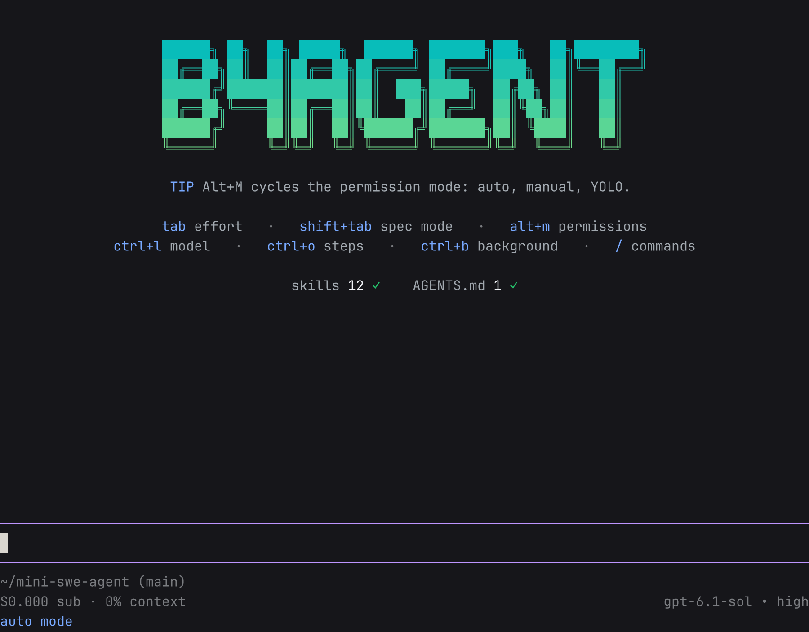

# b4agent

A terminal coding agent built as extensions on [Pi](https://github.com/earendil-works/pi) 1.4.0. Pi's agent loop, tools and sessions stay as they are. b4agent adds the parts I use every day.



- **Permissions:** auto, manual and yolo modes. In auto mode a reviewer model decides what needs your OK, and destructive commands are blocked in every mode.
- **Checkpoints:** every turn snapshots your files, and `/rewind` takes them back.
- **Spec mode:** read-only planning that ends with a spec for you to approve (Shift+Tab).
- **`/btw` and recap:** ask a side question without touching the main context, and get a short recap when you come back to a session.
- **Background jobs:** Ctrl+B moves a running command to the background.
- **Helpers and review:** read-only helpers for search, docs and past sessions, plus `/review` and `/security-review`.
- **The rest:** memory, web fetch and search, Claude Code-style hooks, `/loop` schedules and bundled skills, including office documents and verification skills.

## Install

You need Node.js 24 or newer and git.

```bash
git clone https://github.com/baranbingol1/b4agent-tui
cd b4agent-tui
npm install     # also builds
npm link        # puts `b4agent` on your PATH
```

If `npm link` needs root, link it into `~/.local/bin` instead:

```bash
ln -s "$PWD/dist/src/cli.js" ~/.local/bin/b4agent
```

Then run `b4agent` in any project. If you're not logged in yet, type `/login`.

To update, run `git pull && npm install`. To remove it, run `npm unlink -g b4agent-tui`.

## Configuration

- State lives in `~/.b4agent/`, and your `~/.pi` is left alone. On first run b4agent copies your Pi logins once.
- The default model is gpt-6.1-sol on high effort, through your ChatGPT login.
- Your settings go in `~/.b4agent/b4agent.json`: model roles, hooks, recap and notifications. Per-project settings go in `.pi/b4agent.json`.

## Keys

| Key | Action |
|---|---|
| Tab | reasoning effort |
| Shift+Tab | spec mode |
| Alt+M | permission mode |
| Ctrl+L | model |
| Ctrl+O | expand agent steps |
| Ctrl+B | send to background |
| `/` | all commands |

All of Pi's flags work; `b4agent --help` lists them.

## Development

The layout and checks are in [AGENTS.md](AGENTS.md). Bundled skills and their licenses are in `vendor.json` and `NOTICE`.
